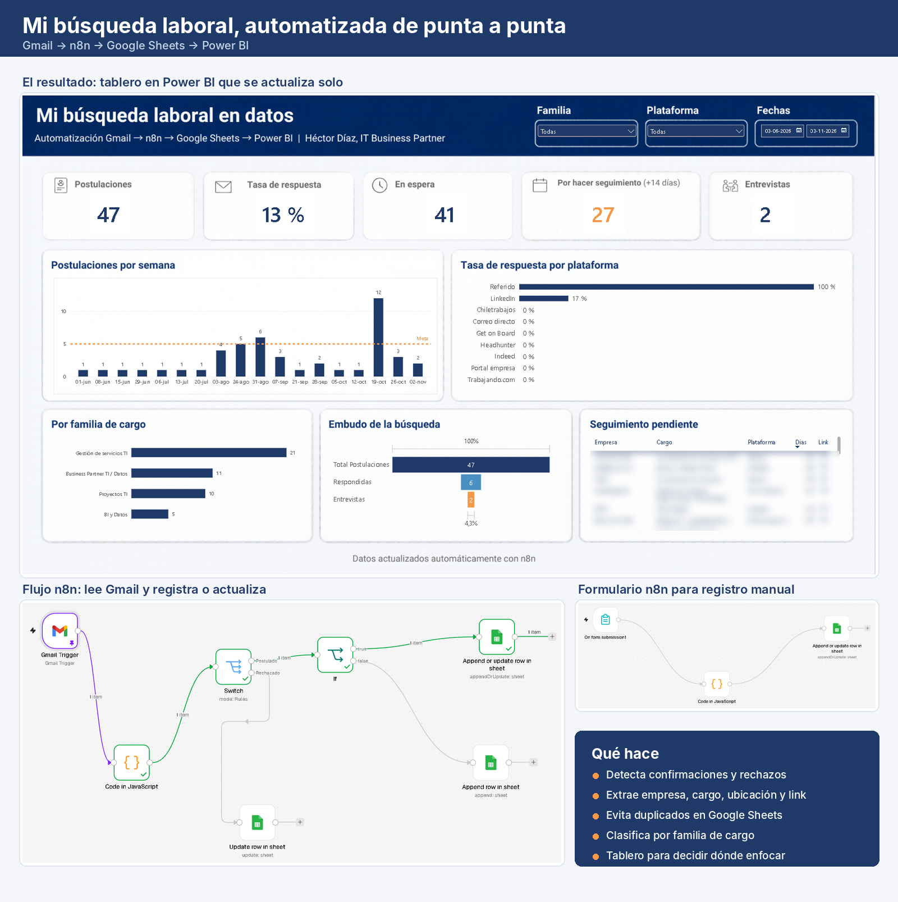
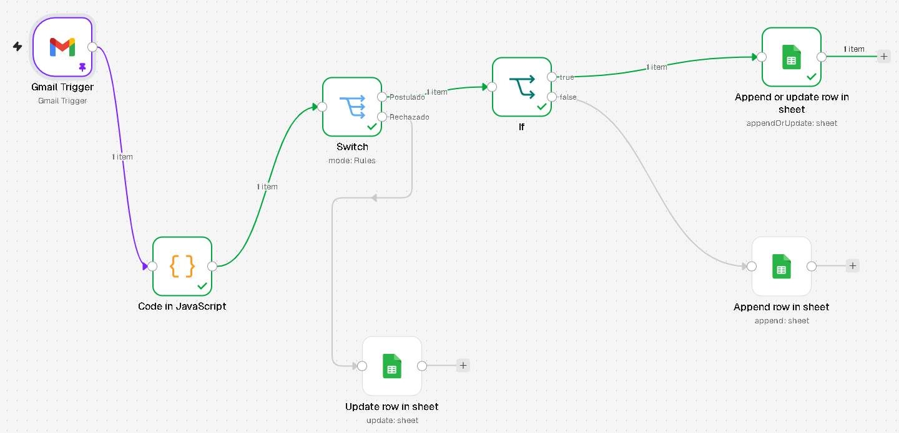
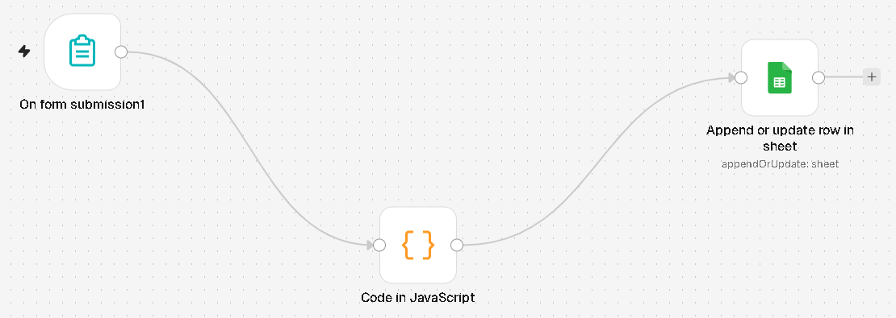
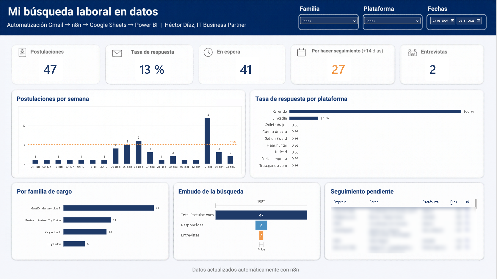

# Mi búsqueda laboral en datos: Gmail → n8n → Google Sheets → Power BI

Automatización que registra sola mis postulaciones laborales a partir de los correos de confirmación y rechazo, y las muestra en un tablero de Power BI para decidir dónde enfocar la búsqueda.

## El problema

Llevaba meses anotando cada postulación a mano en una planilla. Siempre se me quedaba alguna fuera, los rechazos no quedaban registrados y no tenía forma de saber qué estaba funcionando.

## La solución

| Etapa | Herramienta | Qué hace |
|---|---|---|
| 1. Captura | Gmail | Llegan los correos de confirmación y rechazo de LinkedIn, Indeed y Laborum |
| 2. Procesamiento | n8n | Lee cada correo, extrae empresa, cargo, ubicación y link, y detecta si es postulación o rechazo |
| 3. Registro manual | Formulario n8n | Para postulaciones que no llegan por correo (portales de empresa, referidos, Trabajando.com) |
| 4. Almacenamiento | Google Sheets | Guarda todo en una sola tabla, sin duplicados |
| 5. Análisis | Power BI | Tablero con indicadores, tendencias y lista de seguimiento |

## Flujo 1: postulaciones desde Gmail

1. **Gmail Trigger:** revisa el correo cada hora, filtrando por los asuntos de confirmación y rechazo de cada portal.
2. **Code (JavaScript):** limpia el texto del correo (caracteres invisibles, líneas de imágenes, HTML) y extrae los datos según el formato de cada portal:
   - LinkedIn: cargo, empresa, ubicación y link normalizado (`/jobs/view/<id>/`).
   - Indeed: cargo desde el asunto y link normalizado (`viewjob?jk=<id>`).
   - Laborum: cargo desde el cuerpo del correo.
   - Clasifica cada cargo en una **familia** (Gestión de servicios TI, Business Partner TI / Datos, BI y Datos, Proyectos TI) y la empresa en un **rubro**.
3. **Switch:** separa postulaciones de rechazos.
4. **If:** si la postulación trae link, usa **Append or Update** con el link como clave, así nunca se duplica. Si no trae link, la agrega como fila nueva.
5. **Update row:** cuando llega un rechazo, actualiza el estado de esa postulación a "Rechazado".

## Flujo 2: formulario de registro manual

Un formulario web de n8n para registrar postulaciones que no generan correo: link del aviso, empresa, cargo, descripción del cargo, renta pedida, plataforma, notas y fecha.

- Normaliza el link igual que el flujo de Gmail, para que ambos calcen sobre la misma fila.
- Solo envía los campos que tienen datos, para no borrar información que ya existe en la planilla.
- Si no hay link, no escribe nada.

## El tablero en Power BI

- **Tarjetas:** total de postulaciones, tasa de respuesta, en espera, pendientes de seguimiento (+14 días) y entrevistas.
- **Postulaciones por semana** con una meta de 5 postulaciones.
- **Tasa de respuesta por plataforma** (con tasa de entrevista en el tooltip).
- **Postulaciones por familia de cargo.**
- **Embudo:** postulaciones → respondidas → entrevistas.
- **Seguimiento pendiente:** postulaciones con más de 14 días sin respuesta, con link al aviso.
- Diseño de fondo hecho en Canva y usado como imagen de lienzo en Power BI.

## Lo que mostraron los datos

- Por **contactos (referidos)**: 3 postulaciones y 2 entrevistas.
- Por **portales**: más de 40 postulaciones y ninguna entrevista todavía.
- Solo el **4%** de las postulaciones llegó a entrevista.
- El ritmo fue irregular: semanas de 12 postulaciones y semanas de 1.

**Conclusión:** la red de contactos pesa mucho más que los portales.

## Cómo usarlo

1. Instala n8n (por ejemplo, `npx n8n`) y ábrelo en `http://localhost:5678`.
2. Crea una planilla de Google Sheets con estas columnas en la fila 1:
   `ID, Fecha, Empresa, Cargo, Familia, Rubro, Ubicación, Calce %, Prioridad, Estado, Renta, Plataforma, Link, Red / contacto, Notas, Descripción del cargo`
3. En n8n, importa los archivos de la carpeta [`workflows/`](workflows/) (**… → Import from file**).
4. Conecta tus credenciales de **Gmail** y **Google Sheets** en cada nodo.
5. En los nodos de Google Sheets, reemplaza `TU_ID_DE_GOOGLE_SHEET` y `TU_ID_DE_HOJA` eligiendo tu planilla y tu hoja en la lista.
6. Publica (activa) los dos flujos.
7. En Power BI, conéctate a la planilla con el conector **Hojas de cálculo de Google**.

## Tecnologías

n8n · JavaScript · Gmail API · Google Sheets · Power BI (Power Query, DAX) · Canva

## Autor

**Héctor Díaz** · IT Business Partner | BI y automatización · Santiago, Chile
